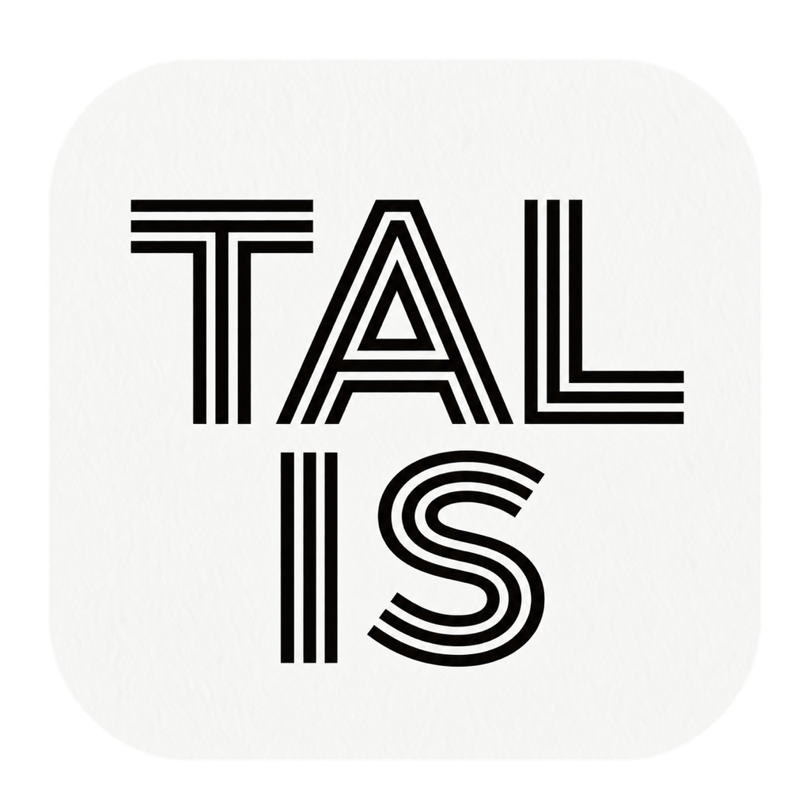

<p align="center"></p>

# Talis for macOS

把想法写清楚，再交给 AI。

Talis 是 Mac 上随时可以唤起的 Prompt 工作台。写下想法，让追问模式帮你补齐目标和条件。需求明确后，再微调表达或重新组织。把满意的请求复制到常用的 AI 工具。经常重复的任务可以保存为个人模板。

连续修改会结合最近三轮上下文。展开历史可以回看查询与结果，开始新任务时清空即可。

## 安装

源码版 0.1.0 需要 macOS 13+、Swift 5.9+ 和 macOS SDK，当前验证覆盖 Apple Silicon。Intel 尚未验证。源码构建不需要付费 Apple Developer 会员。项目没有第三方 Swift Package 依赖。

### 让本机 AI agent 帮你安装

复制下面这一句到能够操作这台 Mac 终端的 agent：

> 请读取 https://raw.githubusercontent.com/viowai/7viow-talis/main/docs/agent-install.md，按说明在我的这台 Mac 上安装并打开 Talis，保留已有模板和设置，并带我完成第一次使用。

Codex 本机源码路径已验证。Claude Code、Cursor、Gemini CLI、VS Code 本地 agent 等在具备相应权限时可使用同一份指引，尚未逐宿主实测。系统确认和首次 API Key 配置由你完成。仅网页聊天或云端 Linux 任务无法直接安装到这台 Mac。详见 [agent 安装指引](docs/agent-install.md)。

### 自己从源码安装

在 Mac 终端执行：

```bash
git clone https://github.com/viowai/7viow-talis.git
cd 7viow-talis
bash scripts/install_app.sh && open /Applications/Talis.app
```

如果缺少 Apple 开发工具，先运行 `xcode-select --install` 并完成系统提示。已有 Talis 时，先保留正在编辑的文字并退出，再安装。安装器会备份原 App，个人模板和设置独立保留。具体步骤和故障处理见[安装说明](docs/install.md)。

当前提供源码安装，没有经过 Apple 公证的即装即用下载版。

## 完成第一次使用

先试一次无需 API Key 的编辑与复制：

1. 打开 Talis，按 `Option + Space` 唤起输入框。
2. 输入下面的示例，按 `Command + Return` 复制，再粘贴到常用的 AI 工具。

> 帮我写一段给大学生看的番茄钟产品介绍，80字以内。产品只支持 macOS，有25分钟计时和暂停继续；不要添加未提供的功能。

需要 Talis 帮你改写时，从菜单打开“设置 AI 模型”，选择供应商并填写自己的 API Key。回到示例，点击“AI 微调”保留结构调整表达，或点击“重新生成”重新组织请求。还没想清楚需求时，使用“追问模式”，选择答案、自己补充或跳过尚未确定的信息。

接着补充“语气轻松，保留全部产品事实”，继续修改。最近三轮上下文会参与处理。点击历史摘要可以展开查看。满意后复制，换任务时清空。

## 按任务选择起点

| 当前情况 | 用法 |
|---|---|
| 想法还模糊 | 先写下来，用追问模式补齐条件 |
| 已经写好请求 | 微调表达，或重新组织请求 |
| 经常做相同任务 | 输入 `/` 选择系统模板，或打开“我的模板”。用 Tab 填写占位符 |

系统模板覆盖写作、改稿、PPT、界面设计与评审、资产研究和研究建站。把整理好的请求复制给相应 AI 工具或 skill/s，接着完成专业任务。Talis 可以独立使用，具体交接示例见[与 skill/s 配合](docs/with-skills.md)。

## 模型与数据

编辑、模板填空和复制可离线使用。AI 微调、重新生成、追问和 AI 生成模板需要联网及所选供应商的 API Key，调用费用由供应商收取。AI 工具订阅不代表已包含这些 API 额度。

模型设置提供 DeepSeek、Moonshot、MiniMax 和 OpenAI 选项，目前真实请求验证使用 DeepSeek。模型、账号和区域可用性取决于各自服务。密钥按供应商分别保存在 macOS Keychain，不在设置页回显。AI 请求由 App 直接发送到所选供应商，详情见[隐私与数据](docs/privacy.md)。

## 快捷键

| 操作 | 快捷键 |
|---|---|
| 唤起或隐藏 | Option + Space |
| 打开模板菜单 | / |
| 切换模板来源／填写下一个占位符 | Tab |
| 插入选中模板 | Return |
| 撤销 | Command + Z |
| 复制 | Command + Return |
| 收起菜单或窗口 | Escape |

## 构建与检查

只构建，不替换已安装的 App：

```bash
bash scripts/build_desktop_app.sh
```

产物在 `~/Library/Caches/Talis/Build/desktop/Talis.app`。检查构建环境用 `bash scripts/check_environment.sh`，检查安装条件用 `bash scripts/install_app.sh --check`。预检只报告环境条件，不构建或安装 App，也不读取 API Key。

## 使用边界与反馈

追问每轮提供 1–3 个问题，最多五轮。信息完整时可直接生成最终 Prompt。三轮上下文服务于当前编辑过程，没有跨设备同步或长期记忆。请检查生成结果是否保留了你的条件。

Talis 通过复制文本与其他工具配合，不自动发送请求、传输附件或安装、执行外部 Agent Skills。Prompt Service 和 Talis Codex 不包含在本桌面版中。

遇到问题，请在 [GitHub Issues](https://github.com/viowai/7viow-talis/issues) 提供 App 版本、macOS 版本、芯片类型、操作步骤和错误信息。版本可从应用菜单的“关于 Talis”查看。反馈前移除 API Key 和私人材料。

## 许可与署名

维护者 Viow，Talis 属于 7viow 产品系列。应用源码及原创文档采用 [Apache License 2.0](LICENSE)，Copyright 2026 Wenbin Li。版权声明见 [NOTICE](NOTICE)。

Montserrat 字体采用独立的 SIL Open Font License 1.1。原作者署名及完整许可见 [THIRD-PARTY-NOTICES.md](THIRD-PARTY-NOTICES.md) 和[字体许可](Resources/Fonts/OFL.txt)。
